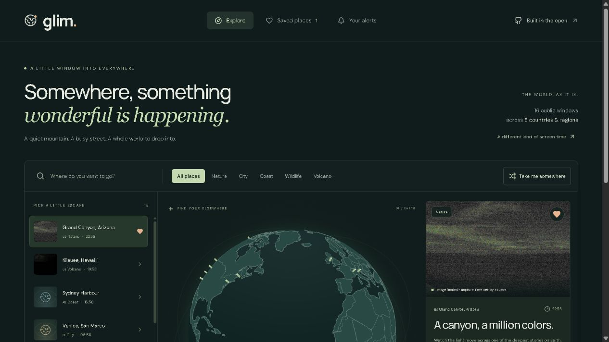

<p align="center"></p>
<h1 align="center">glim.</h1>
<p align="center"><strong>A little window into everywhere.</strong><br />Spin the globe. Find a place. Stay for a moment.</p>
<p align="center"><a href="https://github.com/sreyasts/glim/actions/workflows/ci.yml"></a>  </p>

Glim is an open-source globe for **intentionally public webcams**, saved places, and useful weather alerts. Discover a national park, check a harbor, or catch the next sunrise without turning the world into another infinite feed.

This is a runnable first release, not a directory of every internet-connected CCTV camera. Publicly reachable devices are not automatically public broadcasts or licensed for redistribution.



### What works

- **Interactive 3D globe:** bundled Natural Earth geography, camera markers, click-to-focus, rotation control, and an accessible list fallback.
- **Curated global directory:** search by place, country, or operator; filter nature, cities, coast, wildlife, and volcanoes.
- **Source-aware viewing:** periodically refreshed public-domain NPS/USGS images; other operators open on their own websites. No fabricated “live” badges.
- **Saved places and sharing:** persistent favorites, direct `/place/:id` links, native sharing / clipboard, local camera time.
- **Real condition alerts:** rain, snow, wind threshold, and the 15 minutes before predicted sunrise/sunset. Server-side worker, SQLite inbox, transition deduplication, and an hourly cooldown.
- **Optional background Web Push:** opt-in Chrome/Firefox/Safari notifications with VAPID keys. Inbox alerts work without push credentials.
- **Small, honest privacy model:** browser-specific sessions, HTTP-only cookies, ownership checks, and delete-my-data. No analytics or location permission.
- **Deployable:** Node server, Dockerfile, persistent SQLite, CI, page-specific metadata, sitemap, and robots.txt.

### Run it

Requires **Node.js 24+** and npm.

```sh
git clone https://github.com/sreyasts/glim.git
cd glim
npm ci
# Optional: copy .env.example to .env and configure it.
npm run dev
```

Open **http://localhost:5173**. Vite proxies `/api` to the server on port 3001. No API keys are required for local, non-commercial exploration. Keep the server running for alert evaluation.

```sh
npm run check      # API / persistence / alert-engine tests, TypeScript, production build
npm run build
npm start          # Serves dist + API on http://127.0.0.1:3001
```

For a single-server local preview of the production build, set `APP_ORIGIN=http://127.0.0.1:3001` in `.env`. `APP_ORIGIN` must exactly match the browser origin for writes to succeed. Production requires an HTTPS origin.

### Set a real alert

1. Choose a place and click **Keep an eye on this place**.
2. Select a supported condition. Wind thresholds use km/h.
3. Open **Your alerts** to pause, delete, or inspect alerts.
4. To receive background browser notifications, generate VAPID keys once with `npm run push:keys`, put them in `.env`, restart, and choose **Enable browser push**. Use HTTPS in production.

**These are location-weather alerts, not camera image analysis.** Weather data is modeled and may differ from the camera scene. Alerts evaluate every five minutes by default and appear when a condition first matches. Continued rain does not create repeated messages. Delivery is best-effort; missed events during downtime are not reconstructed. Glim is not an emergency alert service.

### Limits that matter

- Seed coverage is small and curated. Most non-US views currently open at the source rather than playing inside Glim.
- Inline views are snapshots. Neither a successful HTTP request nor an image load establishes when a frame was captured; check the operator's timestamp.
- Arbitrary requests such as “tell me if a crowd forms” are **not implemented**. See the [roadmap](docs/ROADMAP.md) for the evidence and rights needed to add visual alerts.
- Sessions expire after 30 days and do not sync across devices. Losing the cookie loses access to that session's data; expired data is removed by the worker.
- SQLite and the worker target **one persistent server instance**. Static hosting alone cannot run the alert service.
- Open-Meteo's free endpoint is **non-commercial only**. A revenue-generating deployment needs an appropriate plan and `OPEN_METEO_API_KEY`.
- A globe UI does not create demand. The [launch plan](docs/LAUNCH.md) starts with weather-aware travelers and photographers and specifies retention gates before paid acquisition.

### Project map

```text
src/                 React interface, globe, API client
shared/cameras.ts    Curated camera register and rights metadata
shared/types.ts      Shared types and validated rule inputs
server/app.ts        Fastify API, sessions, origin checks, static hosting
server/db.ts         SQLite store and persistence
server/engine.ts     Background rule evaluation and deduplication
server/weather.ts    Cached, coalesced Open-Meteo requests
public/sw.js         Opt-in background Web Push
tests/               Ownership, validation, persistence, and alert-engine tests
```

[Deployment & operations](docs/DEPLOYMENT.md) · [Sources & rights](docs/SOURCES.md) · [Product & launch plan](docs/LAUNCH.md) · [Roadmap](docs/ROADMAP.md) · [Contributing](CONTRIBUTING.md) · [Security](SECURITY.md)

### Help open another window

[Suggest a public webcam](https://github.com/sreyasts/glim/issues/new?template=camera.yml), improve accessibility, or help build an authorized provider integration. Please submit the original operator's public page and its reuse policy. Do not submit camera IPs, credentials, or private streams.

### License and credits

Code: [MIT](LICENSE). The code license does not license camera content. NPS and USGS operators are credited in the app; read each source's restrictions. Weather: [Open-Meteo](https://open-meteo.com/), [CC BY 4.0](https://creativecommons.org/licenses/by/4.0/). Geography: [Natural Earth](https://www.naturalearthdata.com/about/terms-of-use/), distributed through world-atlas. Fonts: DM Sans and Manrope (SIL Open Font License, bundled through Fontsource). Icons: Lucide (ISC).
