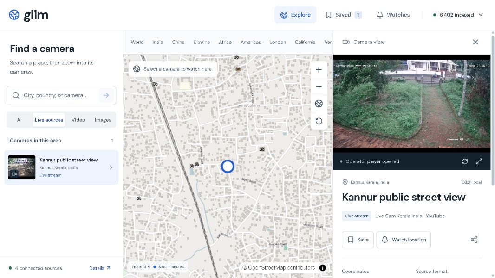

<p align="center"></p>
<h1 align="center">glim.</h1>
<p align="center"><strong>Public camera atlas.</strong><br />Choose a place. Zoom in. Watch the camera here.</p>
<p align="center"><a href="https://github.com/sreyasts/glim/actions/workflows/ci.yml"></a>  </p>

Glim is a map-first explorer for **intentionally public cameras**. It loads official camera networks, clusters their map points, zooms to individual cameras, and plays supported video or images inside the workspace. Saved cameras and location-weather alerts remain available.

This is a runnable camera explorer. Coverage comes from connected public operators; publicly reachable devices are not automatically public broadcasts or licensed for redistribution.



### What works

- **Globe-to-street navigation:** MapLibre globe, camera clusters, geographic zoom, place search, individual markers, and a keyboard-accessible camera index.
- **Connected networks:** official Caltrans district catalogs and TfL JamCams, refreshed at runtime. Optional Windy Webcams API integration adds worldwide discovery by map viewport. Counts reflect loaded metadata, not a claim that every stream is working.
- **Inline viewing:** HLS live video, official YouTube embeds, updated MP4 clips, Windy players, and updating images. Live sources, clips, timelapses, and stills are distinct. Connection status comes from the player.
- **Saved cameras and sharing:** persistent favorites, direct `/place/:id` links, clipboard sharing, local camera time where the source supplies a timezone.
- **Real condition alerts:** rain, snow, wind threshold, and the 15 minutes before predicted sunrise/sunset. Server-side worker, SQLite inbox, transition deduplication, and an hourly cooldown.
- **Optional background Web Push:** opt-in Chrome/Firefox/Safari notifications with VAPID keys. Inbox alerts work without push credentials.
- **Small, honest privacy model:** browser-specific sessions, HTTP-only cookies, ownership checks, and delete-my-data. No analytics or location permission.
- **Deployable:** Node server, Dockerfile, persistent SQLite, CI, page-specific metadata, sitemap, and robots.txt.

### Run it

Requires **Node.js 24+** and npm.

```sh
git clone https://github.com/sreyasts/glim.git
cd glim
npm ci
# Optional: copy .env.example to .env and configure it.
npm run dev
```

Open **http://localhost:5173**. Vite proxies `/api` to the server on port 3001. Caltrans, TfL, and reviewed sources work without API keys. For worldwide Windy discovery, add `WINDY_WEBCAMS_API_KEY` to `.env` and restart the server. It stays server-side; never use a `VITE_` variable for the key. Keep the server running for catalog refresh and alert evaluation.

```sh
npm run check      # API / persistence / alert-engine tests, TypeScript, production build
npm run build
npm start          # Serves dist + API on http://127.0.0.1:3001
```

For a single-server local preview of the production build, set `APP_ORIGIN=http://127.0.0.1:3001` in `.env`. `APP_ORIGIN` must exactly match the browser origin for writes to succeed. Production requires an HTTPS origin.

### Set a real alert

1. Choose a camera and click **Watch location**.
2. Select a supported condition. Wind thresholds use km/h.
3. Open **Watches** to pause, delete, or inspect alerts.
4. To receive background browser notifications, generate VAPID keys once with `npm run push:keys`, put them in `.env`, restart, and choose **Enable notifications**. Use HTTPS in production.

**These are location-weather alerts, not camera image analysis.** Weather data is modeled and may differ from the camera scene. Alerts evaluate every five minutes by default and appear when a condition first matches. Continued rain does not create repeated messages. Delivery is best-effort; missed events during downtime are not reconstructed. Glim is not an emergency alert service.

### Limits that matter

- Worldwide discovery requires a valid Windy key and is subject to its plan. Startup loads country samples from 48 countries, up to 200 entries each for China, the UK, Japan, and South Africa, and up to 1,000 popular worldwide entries within the documented free-tier pagination limit, with two requests at a time. Map movement discovers up to 50 additional entries per area. This is partial coverage, and many entries are timelapses. Windy live entries embed the operator’s stream page; some operators may block embedding, be offline, or require interaction.
- Caltrans advertises HLS streams, some of which can be offline. The player exposes connection failures and offers the source image. TfL serves periodically updated short clips, not continuous live video. Image retrieval time is not capture time.
- Arbitrary requests such as “tell me if a crowd forms” are **not implemented**. See the [roadmap](docs/ROADMAP.md) for the evidence and rights needed to add visual alerts.
- Sessions expire after 30 days and do not sync across devices. Losing the cookie loses access to that session's data; expired data is removed by the worker.
- SQLite and the worker target **one persistent server instance**. Static hosting alone cannot run the alert service.
- Open-Meteo's free endpoint is **non-commercial only**. A revenue-generating deployment needs an appropriate plan and `OPEN_METEO_API_KEY`.
- A globe UI does not create demand. The [launch plan](docs/LAUNCH.md) starts with weather-aware travelers and photographers and specifies retention gates before paid acquisition.

### Project map

```text
src/                 Map workspace, camera player, watches, API client
shared/cameras.ts    Curated camera register and rights metadata
shared/types.ts      Shared types and validated rule inputs
server/app.ts        Fastify API, sessions, origin checks, static hosting
server/db.ts         SQLite store and persistence
server/engine.ts     Background rule evaluation and deduplication
server/weather.ts    Cached, coalesced Open-Meteo requests
server/catalog.ts    Caltrans, TfL, and Windy discovery and source validation
server/stream.ts     Allowlisted Caltrans HLS relay; no arbitrary-URL proxy
server/geocoder.ts   Local GeoNames city/country search; no external geocoder
public/sw.js         Opt-in background Web Push
tests/               Ownership, validation, persistence, and alert-engine tests
```

[Deployment & operations](docs/DEPLOYMENT.md) · [Coverage & checks](docs/COVERAGE.md) · [Sources & rights](docs/SOURCES.md) · [Product & launch plan](docs/LAUNCH.md) · [Roadmap](docs/ROADMAP.md) · [Contributing](CONTRIBUTING.md) · [Security](SECURITY.md)

### Help open another window

[Suggest a public webcam](https://github.com/sreyasts/glim/issues/new?template=camera.yml), improve accessibility, or help build an authorized provider integration. Please submit the original operator's public page and its reuse policy. Do not submit camera IPs, credentials, or private streams.

### License and credits

Code: [MIT](LICENSE). The code license does not license camera content. Operators are credited in the player. Weather: [Open-Meteo](https://open-meteo.com/), [CC BY 4.0](https://creativecommons.org/licenses/by/4.0/). Cartography: [OpenStreetMap contributors](https://www.openstreetmap.org/copyright) and [Natural Earth](https://www.naturalearthdata.com/about/terms-of-use/). MapLibre GL JS: BSD. DM Sans: SIL OFL. Lucide: ISC. Redesign guidance: [Impeccable](https://github.com/pbakaus/impeccable), installed as a local Codex skill; product and design decisions are recorded in `PRODUCT.md` and `DESIGN.md`.
